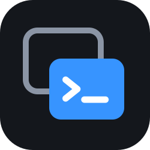

<p align="center">
  
</p>

<h1 align="center">Copane</h1>

<p align="center">
  <b>Your VS Code browser tabs and terminals, shared with Claude Code and other AI agents.</b>
</p>

<p align="center">
  <a href="https://marketplace.visualstudio.com/items?itemName=saka.copane"></a>
  <a href="https://marketplace.visualstudio.com/items?itemName=saka.copane"></a>
  <a href="https://github.com/sak0a/copane/releases"></a>
  <a href="https://github.com/sak0a/copane/actions/workflows/checks.yml"></a>
  <a href="https://github.com/sak0a/copane/blob/main/LICENSE"></a>
  
</p>

Copane gives Claude Code (and Codex, GitHub Copilot and other MCP agents) the VS Code window they run in:
its **integrated browser tabs** and its **integrated terminals**. The agent and you work in the
same tabs and the same terminals. You see every click and every command, and you can take over at
any moment.

- An agent opens your dev server in a browser tab next to your code, clicks through it, reads the
  console, takes screenshots, and you watch it happen.
- An agent starts a dev server or a test run in a real terminal you can see and type into. When a
  command needs you (a password, a 2FA code, a browser login), it hands the terminal to you instead
  of asking for secrets in chat.
- Several agent sessions can work in one window, in several windows at once, each with its own
  label and color ("Claude 1", "Claude 2") on the tabs and terminals it uses.

It works with the **Claude Code extension for VS Code** (its chat sessions), with the **`claude`
CLI** in the integrated terminal, with **Codex** (`codex` CLI and extension), and with **GitHub
Copilot** (the `copilot` CLI, and Copilot chat in VS Code; see [GitHub Copilot](#github-copilot)).

## Install

Install **Copane** from the Visual Studio Marketplace: search for *Copane* in the Extensions view, or
`code --install-extension saka.copane`. Each release is also on
[GitHub](https://github.com/sak0a/copane/releases) as a `.vsix` (Extensions view → `…` →
*Install from VSIX…*). For editors that install from Open VSX, see [Other editors](#other-editors).

After installing, the **Get Started with Copane** walkthrough opens once (later: **Copane: Get
Started** in the Command Palette, or the rocket in the Copane view's title bar). It checks off each
step from the real state of your setup:

1. **Let agents use the integrated browser** (once): **Enable Integrated Browser** adds Copane to
   VS Code's `argv.json`; then **quit VS Code completely and start it again**.
2. **Turn Copane on for your agents** (Claude Code, Codex, GitHub Copilot): adds an MCP server named `copane` to the user
   configuration of the agents that are installed (see
   [what changes on your machine](#what-changes-on-your-machine)).
3. **Try it**: start a *new* Claude Code, Codex or Copilot session and give it the prompt from the walkthrough;
   it opens a browser tab and runs a command in a terminal, both marked with the session's label.
4. **See and control sessions** in the Copane view.

Without the walkthrough the same happens through **Copane: Enable Integrated Browser** and
**Copane: Turn On**, or by answering *Register* when VS Code asks. Sessions that were already
running before step 2 do not see the new server; start them again (in Claude Code and the Copilot
CLI, `/mcp` shows the `copane` server and its state).

### Why the browser needs a restart

VS Code's integrated browser is controlled through an API that is still marked *proposed*. VS Code
lets an extension use a proposed API only when you allow it by name, with
`"enable-proposed-api": ["saka.copane"]` in VS Code's `argv.json` (the file behind
**Preferences: Configure Runtime Arguments**). VS Code reads that file only when it starts, so
reloading the window is not enough. The command edits the file for you, keeps everything else in
it, and offers to quit VS Code. Until then, everything except the browser tools works.

## Tools

The agent sees the tools as `mcp__copane__<tool>`:

- **`browser_*`**: list, open and close tabs; navigate; read the page (accessibility snapshot,
  text, console, network); click, type, fill forms, evaluate scripts; screenshots.
- **`terminal_*`**: create terminals, run commands and read their output and exit codes, send
  input, wait, interrupt, and hand a terminal to you when it needs a person.
- **`session_info`**, **`session_set_title`**: who the agent is in this window, and a short title
  for its task that you see next to its label.
- **`window_status`**, **`window_select`**: which VS Code window the session uses and why, and
  switching to another one. These two work even when no window is reachable, so an agent can
  always explain why the other tools are missing.

### Tool reference

Tools appear in Claude Code as `mcp__copane__<name>`.

| Area | Tools |
|---|---|
| Session and window | `session_info`, `session_set_title`, `window_status`, `window_select` |
| Browser tabs | `browser_list_tabs`, `browser_open`, `browser_tab` (select, show, release or close a tab), `browser_request_user_input` (hand a tab to the user for a sign-in, captcha or decision), `browser_profiles` (separate login stores) |
| Navigation | `browser_navigate` (a URL, or back, forward, reload) |
| Reading a page | `browser_snapshot` (accessibility tree with element refs; `mode: "text"` for reading, `find` to locate), `browser_screenshot`, `browser_wait_for` |
| Acting on a page | `browser_click`, `browser_type`, `browser_fill_form` (also selects options), `browser_press_key`, `browser_hover`, `browser_scroll`, `browser_drag`, `browser_upload_file`, `browser_handle_dialog`, `browser_evaluate` |
| Debugging a page | `browser_console_messages`, `browser_network_requests` (with `id`: one request's headers and bodies; with `har`: a HAR file), `browser_route` (mock, fail or delay requests) |
| Devices and files | `browser_emulate` (phone and tablet sizes, dark mode, locale, time zone, slow or offline network, slow CPU), `browser_downloads` |
| Testing and audits | `browser_audit` (accessibility with WCAG criteria, keyboard walk, performance), `browser_inspect` (the component and file:line that render an element), `browser_check_change` (what a code change did to the page), `browser_export_test` (the agent's actions as a Playwright test) |
| Terminals | `terminal_run`, `terminal_read`, `terminal_wait`, `terminal_send` (keys `["Ctrl+C"]` stops a command), `terminal_request_user_input` (hand a login or prompt to the user), `terminal_create`, `terminal_list`, `terminal_close` |

Merged after 0.3.0, to make the tool list cheaper: `browser_select_tab`, `browser_show_tab`,
`browser_release_tab` and `browser_close_tab` are `browser_tab` with `action`, `browser_history` is
`browser_navigate` with `action`, and `terminal_interrupt` is `terminal_send` with keys `["Ctrl+C"]`.
The old names still work for one release (not listed; the result names the new call). Permission
allowlists that name them need the new names.

The session indicator in a page can be dragged to any corner; it stays there for that tab and new
tabs start in the corner you last chose.

**Certificate errors.** When an agent opens a site whose certificate the system does not trust
(self-signed, or issued by a company authority), you are asked once per host: *Proceed*, *Always
Trust <host>*, or *Cancel*. *Always Trust* adds the host to
`copane.browser.trustedCertificateHosts`, which you can also fill yourself, e.g.
`["localhost", "*.corp.example"]`. Set `copane.browser.certificateErrors` to `block` to never
proceed for agents. This applies only to tabs an agent session is driving.

**Logins.** When a site or proxy in a tab an agent is driving asks for a login (HTTP
authentication: Basic, Digest, NTLM), you are asked in VS Code and type it into a masked field. The
agent never sees it, only whether you logged in. Each site or proxy is asked once; a rejected login
is asked once more, then the agent is told to stop. *Log In and Remember* saves the login in VS
Code's secret storage; **Copane: Forget Saved Browser Logins** removes saved logins. Turn this off
with `copane.browser.loginPrompts`. Not possible: Windows single sign-on (Kerberos or Negotiate
without typing anything) cannot be provided by an extension.

**Handing a tab to you.** When a page needs you (single sign-on, MFA, a captcha, a consent screen,
a choice only you can make), the agent calls `browser_request_user_input` instead of asking for
your password. The tab comes to the front with what the agent asks for, the agent can neither read
nor use it meanwhile, and you finish with **Done** or **Won't Do** in the tab's title bar, the page
indicator or the Sessions view. The agent can also name a condition (an address, a text on the
page) that ends the hand-off by itself once you are signed in.

**Login profiles.** Tabs normally share one login store: an agent is signed in wherever you are. A
login profile is a separate store (cookies, local storage, cache), so one window can be signed in
to the same site as different accounts, for example `dev`, `test` and `prod`. Agents name one with
`browser_open`'s `profile`; you choose with **Copane: Open Browser Tab in Login Profile…** and
**Set Login Profile for Agent Session…**, or make every agent session start in a private profile
with `copane.browser.agentLoginStore: private`. Profiles live in memory until VS Code quits and
are never written to disk. Details: [docs/browser-profiles.md](docs/browser-profiles.md).

**Accessibility and performance.** `browser_audit` runs axe-core on the page and lists what fails,
each with its WCAG criterion and level (for example `[WCAG 1.4.3 AA]`), the element's ref and how
to fix it, so an agent can fix the code and check again. Automated checks find only part of what
WCAG asks for (roughly a third to a half): a clean report is not a conformance statement. Its
performance mode reports load timing, Web Vitals, the slowest and largest requests, long tasks and
render-blocking resources. `browser_export_test` turns what the agent did in a tab into a
Playwright test you can keep.

**Keyboard, source, and checking a change.** `browser_audit` with `type: "keyboard"` presses Tab
through the page like a keyboard user and reports the focus order, focus that is not visible,
keyboard traps, controls Tab never reaches and a missing or broken skip link, each with its WCAG
criterion; focus and scroll are put back afterwards. `browser_inspect` tells which component and
file:line in your workspace render an element (React, Vue and Svelte in development builds,
inspector plugin attributes; bundled locations go through source maps). `browser_check_change`
takes a baseline before the agent edits code and afterwards waits for the hot update or reload and
reports only what it changed: new errors with their source lines, failed requests, a navigation or
crash, and the changed regions of the screenshot.

**Screenshots as files.** For agents whose client does not pass images to the model,
`browser_screenshot` with `path: "shot.png"` also saves the image (PNG or JPEG by the extension),
written like HAR files and tests: only inside the project, never over a file it did not write.

**Network recording and throttling.** `browser_network_requests` with `har: "network.har"` writes
the tab's requests, including those of iframes from other sites, as a HAR 1.2 file you can open in
Chrome DevTools, Firefox or any HAR viewer. Cookie values, tokens and other secret-looking values
are masked unless the agent asks for them, and response bodies are included only on request.
`browser_emulate` with `network` (`offline`, `3g`, `slow-4g`, `fast-4g` or your own numbers) and
`cpu` (for example `4` for four times slower) shows how a page behaves on a slow connection or
device. Throttling shows on the tab in the Sessions and Agent Tabs views and ends when the agent
releases the tab or you end the emulation.

**Downloads.** When an agent's click or navigation downloads a file, Copane saves it to
`~/Downloads/Copane` (setting `copane.browser.downloadsFolder`) under a name that never replaces an
existing file, and gives the agent the path. By default you are asked once per agent session
(`copane.browser.agentDownloads`: `ask`, `allow`, `deny`). Your own downloads are unchanged. In
remote windows (WSL, SSH, containers) the file ends up on the remote side, where the agent runs (see
below).

**Device emulation and request mocking.** Agents can show a tab as a phone or tablet, in dark or
light mode, with another locale or time zone (`browser_emulate`), and can make requests of a tab
return canned responses, fail or be slow (`browser_route`). Both belong to the session that set them
and end when it releases the tab; both are shown on the tab's row in the Sessions and Agent Tabs
views, and you can end them yourself with **End Agent's Device Emulation in Browser Tab** and
**Remove Agent Request Mocks from Browser Tab**.

**Frames.** Elements inside iframes, including ones from other sites, are read and used like any
other element (up to 10 cross-origin frames per snapshot; the rest can be read one at a time).

Known limits: requests made from inside a cross-origin iframe are not mocked; JavaScript `prompt()`
is not available in VS Code's browser; without shell integration a terminal command's exit code is
unknown.

## How it works

```
Claude Code session ──stdio MCP──▶ ~/.copane/bin/mcp-server ──local socket──▶ VS Code window
(chat tab or `claude` CLI)          (one small process per session)                        (Copane extension)
```

Every agent session starts its own copy of the MCP server. The server finds the VS Code window the
session belongs to, connects to that window over a local socket, and forwards the tools. All tool
logic runs in the extension, in the window.

### Which window a session uses

The server picks the window like this, and reports how it chose (`window_status`):

1. The agent was started by an extension in that window, for example a chat of the Claude Code
   extension: the window's extension host is one of its parent processes.
2. The agent runs in one of that window's integrated terminals (Copane sets
   `COPANE_INSTANCE` in its terminals).
3. The window it was connected to before was reloaded: the new window with the same folders.
4. The agent's working directory is inside the window's workspace (deepest folder wins; if the
   same folder is open twice, the most recently focused window).
5. Only one VS Code window is open.

If several windows are open and none of these applies (an agent started outside VS Code, in a
folder no window has open), the server does not guess. The agent sees `window_status`, which lists
the open windows, and connects with `window_select`.

### Several sessions, several windows

Each session gets a label and a color in its window ("Claude 2", blue) shown on the tabs and
terminals it uses. A session may freely use the tabs and terminals it opened. Using a tab or
terminal *you* opened needs your permission. When two sessions want the same tab, one controls
it and the other can still read it.

The **Sessions** view in the activity bar lists each session with its tabs and terminals. The
**Agent Tabs** view in the bottom panel, next to Terminal and Ports, lists every browser tab an
agent uses, marked with its session's color and label: click one to bring it to the front, or use the
row's buttons to pause or release the agent, close the tab, or go to the session (the agent's own
terminal if it runs in one of this window, otherwise its row in the Sessions view).

A session is identified by Claude Code's conversation id, so it keeps its identity when the window
reloads (the server reconnects by itself and calls wait for the window to come back) and when you
resume the conversation with `claude --resume`. Sub-agents of a conversation share its session.
Windows are independent: each has its own sessions, tabs and terminals.

### Codex

Codex is registered the same way, in `~/.codex/config.toml` (or `$CODEX_HOME/config.toml`). Codex
starts MCP servers with only a few environment variables, so the entry lists the ones Copane
needs (`env_vars`), and it raises Codex's 60-second tool timeout to 10 minutes for long browser
waits and terminal commands. Sessions appear as "Codex 1", "Codex 2" in their own colors.

How Codex treats Copane's tools (checked with Codex CLI 0.167):

- **Approvals.** Codex asks you before every call of a tool that is not marked read-only: opening or
  navigating a tab, clicking and typing, running a terminal command, setting the session title.
  Reading (snapshots, screenshots, console, network, terminal output, status) is not asked about.
  Choose *approve for this session* in Codex's prompt to stop being asked, or set
  `default_tools_approval_mode = "approve"` under `[mcp_servers.copane]` to never be asked. In
  `codex exec` (no prompts), calls that need approval fail unless that setting is on.
- **Sandbox.** Codex's sandbox (`--sandbox read-only`, `workspace-write`) applies to the commands
  Codex runs itself, not to Copane: a command an agent runs with `terminal_run` runs in a VS Code
  terminal with your permissions, in plain view. The approval prompt is the control that applies.
- **Instructions.** Codex lists Copane under its first line of instructions and adds the full
  instructions to each Copane tool it looks up.
- **Which window.** A Codex started in a VS Code terminal finds that window through
  `COPANE_INSTANCE`; a Codex started elsewhere finds the window whose folder contains its working
  directory. Chats of the Codex extension should find theirs as a child process of the window, like
  Claude Code's (not tested yet).
- **Session identity.** Codex gives MCP servers no conversation id at startup, so a Copane session
  lasts as long as the Codex process: it survives window reloads, but `codex resume` starts a new
  Copane session.

### GitHub Copilot

Copilot is registered in `~/.copilot/mcp-config.json` (or `$COPILOT_HOME/mcp-config.json`), as the
`copane` entry under `mcpServers`, in the form `copilot mcp add` writes (`"type": "local"`,
`"tools": ["*"]`). That one file is read by the **Copilot CLI** (`copilot`) and, according to VS
Code's documentation, by **Copilot chat in VS Code** when its sessions run on the Copilot harness
(the Chat view and the Agents window), so one entry covers both. Copane edits the file directly, in
one atomic step: comments, other servers and keys it does not know stay as they are (`copilot mcp
add` itself would drop the comments). Copilot starts local MCP servers with little more than `PATH`
from the environment, so the entry passes the variables Copane needs as references,
`"COPANE_INSTANCE": "${COPANE_INSTANCE:-}"` and the same for `COPANE_SESSION`, which Copilot fills
from its own environment (empty when unset).

- **Tool names.** The model sees Copane's tools as `copane-<tool>`, e.g. `copane-browser_click`.
- **Check it.** `copilot mcp list` or `copilot mcp get copane` shows the entry; `/mcp` in a
  Copilot CLI session shows the server and its state. `copilot mcp disable copane` turns it off
  without removing it; **Copane: Show Status** reports that.
- **Instructions.** The Copilot CLI gives the model the server instructions only of servers it
  allowlists. Start it with `--allow-all-mcp-server-instructions` to include Copane's (how sessions,
  tab access and hand-off work).
- **Fewer tools.** Change the entry's `"tools"` to a list of tool names (without the `copane-`
  prefix) to give Copilot only those, for example when VS Code's limit of 128 tools per request is
  reached. Copane keeps your list, and a `"timeout"` you add, when it updates the entry.
- **How it differs from Copilot's own browser tools.** Copane works in *your* VS Code window: the
  integrated browser tabs you also use (tabs you opened only with your consent), terminals you can
  see and type into, and a hand-off to you when a page or command needs a login, a password or a
  decision. Each Copilot session gets its own label and color on the tabs and terminals it uses.

Known limits: registration was checked with Copilot CLI 1.0.105 (the file format, `COPILOT_HOME`,
`copilot mcp list` reading Copane's entry). How Copilot chat inside VS Code finds the right window
has not been verified with a signed-in Copilot; if it reaches the wrong one or none, the agent can
pick it with `window_select` (`window_status` says which windows there are).

**Experimental: a server for this window only.** With the setting
`copane.vscodeChat.serverDefinition` (off by default), Copane also gives VS Code's own chat a
`copane` server through VS Code's extension API, which starts the same launcher with
`COPANE_INSTANCE` set to this window, so it always connects here instead of guessing from the working
directory. In a test window VS Code's own MCP client started it and it connected to the right
window; a real Copilot chat using it has not been tried. Limits:

- VS Code may show `copane` twice or use the `mcp-config.json` entry instead. VS Code's own list
  keeps one of two servers with the same name (`chat.mcp.collisionBehavior`); what the Copilot
  harness does with both is unknown. If you see two, turn one off: this setting, or the
  `mcp-config.json` entry (`copilot mcp disable copane`, which turns it off for the Copilot CLI too).
- With the Local harness one server serves every chat of the window, so they share one Copane
  session, labelled "Agent 1". How the Copilot harness divides chats into sessions is not known yet.
- In a remote window the definition names the launcher on the remote side, where Copane runs; it
  has not been tried whether the Copilot harness starts it there.

### Remote windows and WSL

In a WSL, SSH or Dev Container window, Copane runs on the remote side, next to your code,
where Claude Code, Codex and the Copilot CLI run too. It registers with the agents' configuration **on the remote
machine** (for WSL: `~/.claude.json` inside WSL), and the server runs with the VS Code server's
Node.js. The browser itself stays on your local machine and VS Code connects it through the window,
so `localhost:3000` in a WSL window reaches the server in WSL.

The browser setting, `argv.json`, belongs to your local VS Code. In a remote window, **Copane:
Enable Integrated Browser** changes it on your local machine through VS Code's connection (it finds
your home folder there; if it cannot tell which one, it opens the file through **Preferences:
Configure Runtime Arguments** and adds the line there). If neither works, it shows the line to add
and copies it to the clipboard. Then quit VS Code on your local machine and start it again.

**Downloads in a remote window.** The browser runs on your computer, so it saves an agent's download
into a private folder there first (`AppData\Local\Temp\copane-downloads` on Windows,
`~/Library/Caches/Copane` on macOS, `~/.cache/copane` on Linux); Copane then copies the file over
VS Code's connection into the agent downloads folder **on the remote side** (`~/Downloads/Copane`
in WSL or on the SSH host), where the agent can read it, and deletes the local copy. A download of
your own caught in such a moment goes to your local Downloads folder. If Copane cannot find your home
folder on your computer, downloads in that window go through VS Code's Save dialog as usual and the
agent is told the file is on your computer.

On native Windows (no WSL), agents start the server with VS Code's own executable
(`Code.exe` with `ELECTRON_RUN_AS_NODE=1`), which Copane updates when VS Code moves.

## Other editors

Copane needs VS Code's integrated browser and its proposed `browser` API for the browser tools, and
VS Code 1.140 or newer (`engines.vscode`) to install at all. The terminal tools work without the
browser. Where an editor lacks the integrated browser, the walkthrough and **Copane: Show Status** say
so instead of offering a fix. What we found by inspecting each editor's release (November 2026):

| Editor | Based on | Integrated browser and `browser` API | Copane |
|---|---|---|---|
| Visual Studio Code | 1.140+ | yes | works fully (Marketplace) |
| VSCodium 1.143 | VS Code 1.143 | included in the build | should work fully: `argv.json` is `~/.vscode-oss/argv.json` (not verified in a running editor) |
| Windsurf / Devin Desktop 3.12 | VS Code 1.141 | included in the build | should work fully: `argv.json` is `~/.devin/argv.json`; its extension gallery is its own (not verified in a running editor) |
| Cursor 3.30 | VS Code 1.128 | no (its agent browser is Cursor's own) | cannot install: older than 1.140 |
| Positron 2026.11 | VS Code 1.138 | not checked | cannot install yet |

Editors other than VS Code install extensions from [Open VSX](https://open-vsx.org). Until Copane is
published there, install the `.vsix` from the
[releases](https://github.com/sak0a/copane/releases/latest) (*Install from VSIX…*). **Copane: Enable
Integrated Browser** finds each editor's own `argv.json` (its data folder), and **Copane: Turn On**
works the same in every editor.

## What changes on your machine

Copane asks before it changes any agent's configuration, and changes only what it describes:

| File | Change | When |
|---|---|---|
| `~/.claude.json` (or `$CLAUDE_CONFIG_DIR/.claude.json`) | `mcpServers.copane`, a user-scope MCP server | After you agree, or with the Register command. Made with Claude Code's own `claude mcp` command when it is available, so it does not race with a running Claude Code. |
| `~/.codex/config.toml` (or `$CODEX_HOME/config.toml`) | the `[mcp_servers.copane]` table | Same. The rest of the file, comments included, is left exactly as it was. |
| `~/.copilot/mcp-config.json` (or `$COPILOT_HOME/mcp-config.json`) | `mcpServers.copane` | Same. Edited directly in one atomic step; comments, other servers and your own `tools` filter are kept. |
| VS Code's `argv.json` | adds Copane to `enable-proposed-api` | When you run **Enable Integrated Browser**. Comments and other entries are kept. |
| `~/.copane/` | the MCP server, a small launcher, one file per open window (socket path and a random token, readable only by you) | Always; this is Copane's own folder. |

Copane never changes or removes a `copane` MCP server that it did not add. If you already
have one, it asks whether to replace it. Its own entry points to
`~/.copane/bin/mcp-server`, which stays the same across extension updates, so your
agent configuration does not need to change when the extension updates.

On Windows the entry starts VS Code's own runtime (`Code.exe`) with the server script, because
agents cannot start a `.cmd` launcher there. It is rewritten only when that runtime is gone; an entry
written by another VS Code build that is still installed (Stable and Insiders) is left as it is.

Once you have agreed, Copane keeps its entry present and current: if something removes it
(`claude mcp remove`, or Claude Code resetting a damaged config), the next VS Code start adds it back
and says why in the log. An update replaces the entry in one step and never removes it first. Every
change is logged in the **Copane** output channel with its reason and kept in
`~/.copane/registration-history.json`.

**Turn it off** with **Copane: Turn Off (Unregister from Claude Code, Codex and Copilot)**. It removes
Copane's entries and nothing else, and Copane does not add them back until you run
**Copane: Turn On**. Run it before uninstalling the extension if you do not plan to reinstall it.

## Security model

- **Local only.** The windows listen on a Unix socket in `~/.copane/run/` (a named pipe
  on Windows), never on a network port. The folder is readable only by you, and every connection
  must present the window's random token, which is in a file only you can read.
- **Your tabs and terminals are yours.** An agent can use the tabs and terminals it opened. To read
  or control a tab or terminal you opened, it needs your permission (settings
  `copane.browser.userTabs` and `copane.terminal.userTerminals`: ask, allow or deny).
- **You can always take over.** Pause an agent's access to a tab, type into its terminals, or end a
  session from the Sessions view.
- **Secrets stay with you.** When a command needs a password or a login, the agent hands you the
  terminal; it sees only what the terminal shows afterwards.
- An agent that can use the browser can do in it whatever you could: treat it like any other tool
  you allow an agent to use, and keep Claude Code's permission prompts on for actions you want to
  confirm.

## Commands

| Command | |
|---|---|
| Copane: Get Started | Opens the getting-started walkthrough, with each step checked off from the real state of the setup. |
| Copane: Check and Repair Setup | Checks everything end to end (entries present and current, server script and runtime, a real start of the server with an MCP handshake, this window reachable), fixes Copane's own entries and says what was wrong and what it did. The same check runs quietly at every start. |
| Copane: Turn On (Register with Claude Code, Codex and Copilot) | Adds the `copane` MCP server to the agents' user configuration and keeps it there. |
| Copane: Turn Off (Unregister from Claude Code, Codex and Copilot) | Removes Copane's entries and keeps them off. |
| Copane: Enable Integrated Browser | Allows the proposed browser API in `argv.json` and offers to quit VS Code. |
| Copane: Show Status | Everything about this window, the browser, the agents, the server's start test, recent registration changes and the connected sessions, in one report. |
| Copane: Copy Status Report | Puts that report on the clipboard (also the copy button above the report). |
| Copane: Show Log | The extension's log. |
| Copane: Answer Agent Question | Answers a question an agent's action is waiting on (the same as clicking its status bar item). |
| Copane: Open Browser Tab in Login Profile… | Opens a tab in a separate login store. |
| Copane: Set Login Profile for Agent Session… | Chooses the login store a session's new tabs use. |
| Copane: Forget Saved Browser Logins | Removes logins saved with *Log In and Remember*. |

## Settings

| Setting | Default | |
|---|---|---|
| `copane.registration.mode` | `ask` | `ask`: ask once before registering. `automatic`: register without asking. `manual`: only the commands change agent configuration. |
| `copane.registration.claudeCode` | `true` | Register with Claude Code. |
| `copane.registration.codex` | `true` | Register with Codex (when it is installed). |
| `copane.registration.copilot` | `true` | Register with GitHub Copilot (when the `copilot` CLI, `~/.copilot` or the Copilot Chat extension is found). |
| `copane.browser.userTabs` | `ask` | Whether agents may use tabs you opened: ask, always allow or never. |
| `copane.browser.agentLoginStore` | `shared` | `shared`: agents' tabs use your login store. `private`: every agent session starts in a login profile of its own. |
| `copane.browser.loginPrompts` | `true` | Ask you for site and proxy logins in tabs an agent drives. |
| `copane.browser.agentDownloads` | `ask` | Whether agents' actions may download files: `ask`, `allow`, `deny`. |
| `copane.browser.certificateErrors` | `ask` | What to do for agents on a site with an untrusted certificate: `ask` or `block`. |
| `copane.sessionGraceSeconds` | `20` | How long a disconnected session keeps its tabs and terminals, so it can reconnect after a reload. |
| `copane.tools.profile` | `full` | Which tools agents get. `core` keeps the everyday ones (pages, tabs, dialogs, hand-off, terminals) and leaves out the dev and test extras (`browser_emulate`, `browser_route`, `browser_audit`, `browser_check_change`, `browser_inspect`, `browser_export_test`, `browser_profiles`) and rarely used tools (`browser_hover`, `browser_drag`, `browser_upload_file`, `browser_downloads`, `session_info`): 28 instead of 40 tools, about a third less context in every conversation. Useful for agents that load every tool up front (Copilot, Codex) and for VS Code's limit of 128 tools per request. Connected agents get the new list at once. |
| `copane.tools.disabled` | `[]` | Tool names agents do not get, on top of the profile, e.g. `["browser_route"]`. A call to one is refused with a message saying so. `window_status` and `window_select` always stay; unknown names are ignored. |
| `copane.usageNotesInResults` | `true` | Give Copilot sessions Copane's usage notes with their first tool result (Copilot does not pass server instructions on). Turn it off if you start Copilot with `--allow-all-mcp-server-instructions`, so the notes do not arrive twice. |

## Troubleshooting

Run **Copane: Check and Repair Setup** first: it fixes what it can and says what it found.
**Copane: Show Status** then explains the rest; when asking for help, send that report
(**Copy Status Report**) and the output of **Copane: Show Log**.

**Claude Code does not list the `copane` server.** Start a new session: agents read their MCP
configuration when a session starts. Check that the status report says *registered ✓* for Claude
Code. If you use `CLAUDE_CONFIG_DIR`, VS Code must be started with the same value. A project can
override user-scope servers with its own `copane` server (`.mcp.json`, or `claude mcp add` in local
scope); the report lists such projects.

**The server is listed but has no browser or terminal tools.** Ask the agent to call
`window_status`. Typical answers: no VS Code window with Copane is open (the tools appear on
their own a few seconds after one opens), or several windows are open and the agent was started
outside all of them (it can pick one with `window_select`).

**Browser tools say the browser is not enabled.** Run **Enable Integrated Browser** and quit and
restart VS Code completely. If the report says *enabled in argv.json, but VS Code has not been
restarted*, the restart is what is missing.

**After a window reload, an agent's call failed.** A call that was running at the moment of the
reload cannot finish; the agent is told so and can repeat it. Calls made during the reload wait for
the window to come back.

**`node` is not installed.** Not needed: the server runs on VS Code's own runtime.

**The self-test fails with "could not be started".** The launcher in
`~/.copane/bin/` points to a VS Code that is no longer there. Opening a window with
Copane rewrites it.

Still stuck: copy the status report and the output of **Copane: Show Log** into an issue.

## Development

See [CONTRIBUTING.md](CONTRIBUTING.md), `CLAUDE.md` and `docs/ARCHITECTURE.md`. `npm run check`
type-checks, tests and builds; `node scripts/dev-host.mjs --name <name>` starts an isolated VS Code
with the extension and with throwaway Claude Code, Codex, Copilot and `argv.json` configuration;
`node scripts/e2e.mjs` runs the end-to-end suites.

## Acknowledgements

Copane builds on ideas from
[thimo/vscode-integrated-browser-mcp](https://github.com/thimo/vscode-integrated-browser-mcp)
(MIT, © Thimo Jansen): driving the integrated browser through the proposed API and CDP, finding the
right window through per-window instance files and the working directory, and copying the MCP
server to a stable location outside the extension folder.

## License

Copane is licensed under the [PolyForm Shield License 1.0.0](LICENSE). In plain words, and not
replacing the license text:

- You may use Copane for anything, including at work in a company, and change and share it.
- You may not use it to offer a product that competes with Copane, for example by repackaging or
  selling it.

Versions up to and including 0.2.0 were published under the MIT license and remain available under
it. The open-source packages Copane bundles keep their own licenses; see
[THIRD_PARTY_NOTICES.md](THIRD_PARTY_NOTICES.md).
